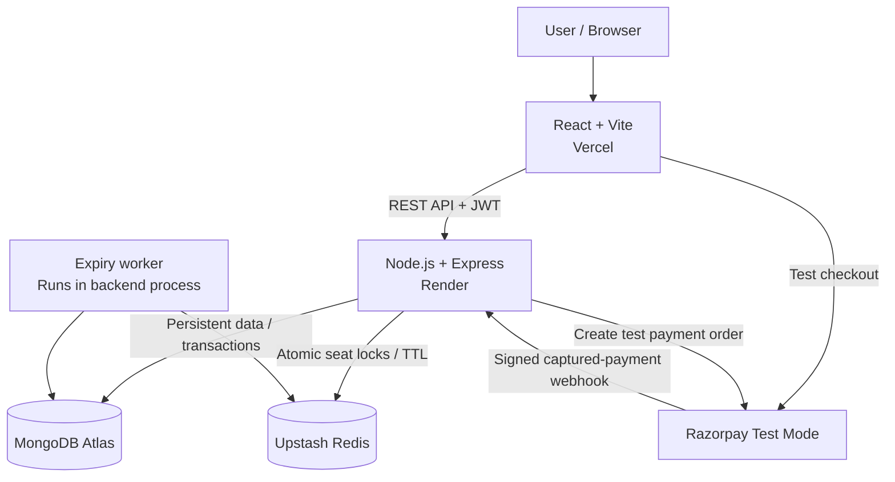
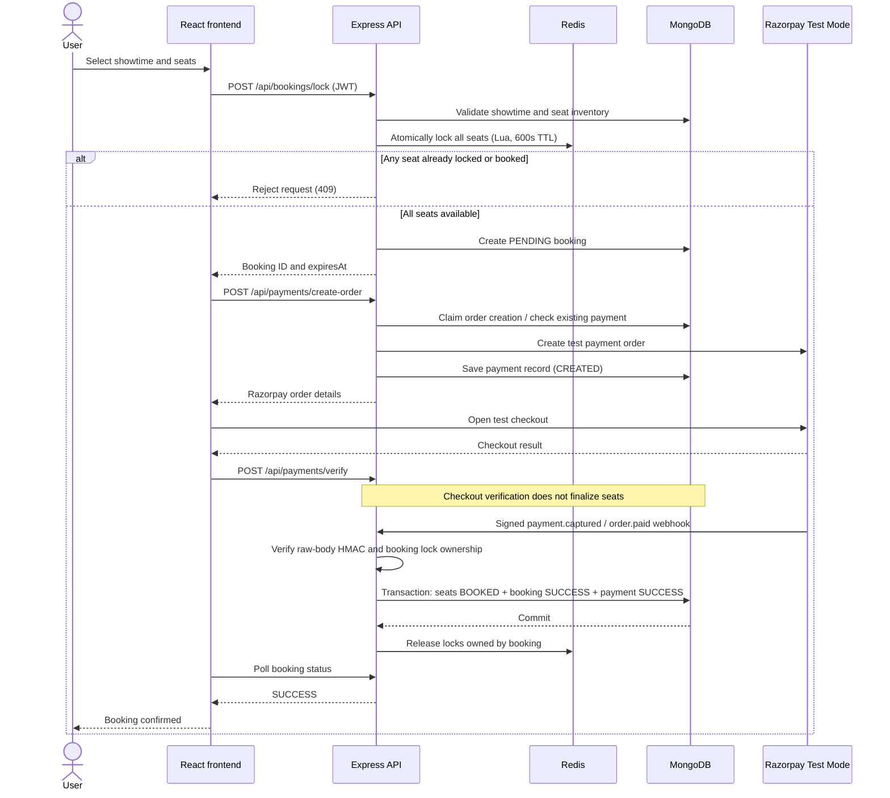
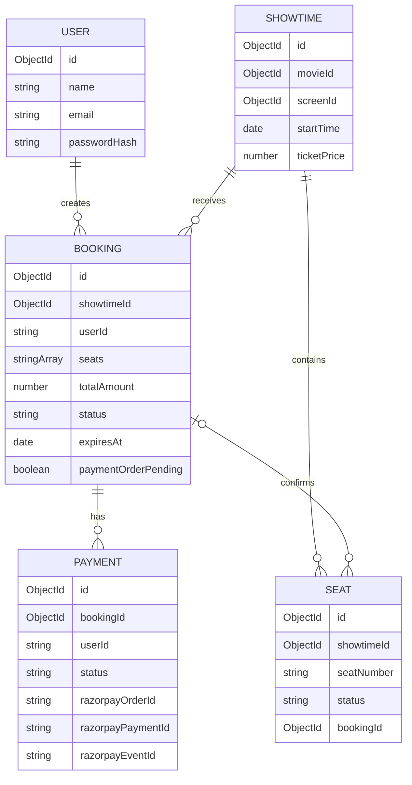

# Seat Lock Engine

**A concurrency-aware seat reservation system built with React, Node.js, Redis, MongoDB, and Razorpay Test Mode.**

[**Live Demo**](https://seat-lock-engine.vercel.app) · [**Source Code**](https://github.com/ayushkumar1420/seat-lock-engine)

> **Portfolio / learning project.** This application demonstrates seat-locking, transaction handling, payment verification, and failure recovery. Razorpay is intentionally used in **Test Mode only**. No real payments are accepted.

## Overview

When multiple users attempt to reserve the same seat at the same time, a conventional check-then-book approach can lead to double-booking. Seat Lock Engine uses **atomic Redis locks** to temporarily reserve seats and **MongoDB transactions** to make successful reservations permanent.

A user selects seats, receives a **10-minute reservation window**, completes a simulated Razorpay payment, and receives booking confirmation only after the backend verifies a captured-payment webhook.

### Key engineering concepts

- **Atomic multi-seat locking:** Redis Lua scripts check and acquire all requested seat locks together.
- **Lock ownership:** Each Redis lock belongs to a specific booking ID; cleanup cannot delete another booking's lock.
- **Transactional confirmation:** Seats, booking, and payment records are finalized together using a MongoDB transaction.
- **Webhook-driven payments:** The browser's checkout callback does not mark seats as booked; a verified Razorpay webhook drives finalization.
- **Idempotency and concurrency safeguards:** Duplicate payment-order requests and repeated webhook events are handled defensively.
- **Expiry and recovery:** Redis TTLs, a background expiry worker, booking-status polling, and frontend recovery help manage interrupted flows.

## Live architecture



**Deployment:** Frontend on Vercel, API and expiry worker on Render, MongoDB Atlas for persistence, Upstash Redis for locks, and Razorpay **Test Mode** for payment simulation.

## Booking workflow



### Why two data stores?

**Redis** handles temporary, high-contention seat reservations. A key such as `seats:<showtimeId>:A1` stores the owning `bookingId` with a **600-second TTL**. A Lua script checks every requested seat and sets all locks atomically.

**MongoDB** stores users, showtimes, seats, bookings, and payments. During payment finalization, a transaction changes all requested available seats to `BOOKED`, updates the booking to `SUCCESS`, and updates the payment to `SUCCESS`. If any required update fails, the transaction is aborted rather than partially booking a group of seats.

The two systems are **not part of one distributed transaction**. The implementation uses ownership-aware cleanup and expiry to manage common failure cases.

## Features

- User registration and login with bcrypt password hashing and JWT authentication.
- Future showtime listing and seat availability (`AVAILABLE`, `LOCKED`, `BOOKED`).
- Automatic 12-seat inventory (A1–A4, B1–B4, C1–C4) when creating a showtime.
- Multi-seat reservation with atomic Redis Lua locking and a 10-minute countdown.
- Server-calculated ticket totals based on stored showtime prices.
- Razorpay **Test Mode** order creation, checkout signature verification, and signed webhook handling.
- Booking/payment status polling and pending-booking recovery after refresh.
- Expiry worker checking pending bookings approximately every 10 seconds.
- Rate limiting on authentication, seat-lock, and payment-order endpoints.

## Tech stack

| Layer | Technology |
| --- | --- |
| Frontend | React, Vite, JavaScript, CSS |
| Backend | Node.js, Express |
| Authentication | JWT, bcryptjs |
| Database | MongoDB, Mongoose |
| Distributed locking | Redis, ioredis, Lua scripts |
| Payment simulation | Razorpay **Test Mode** |
| Hosting | Vercel (frontend), Render (API), MongoDB Atlas, Upstash Redis |

## Data model



**Important constraints:** unique `(showtimeId, seatNumber)` for seats, unique Razorpay order ID, and a partial unique index preventing multiple `CREATED` payment records for the same booking. Bookings are indexed by `(status, expiresAt)` for expiry checks.

### State transitions

| Entity | States and relevant behavior |
| --- | --- |
| Booking | `PENDING` → `SUCCESS` on successful webhook finalization; `PENDING` → `EXPIRED` after timeout. The schema also defines `FAILED`. |
| Payment | `CREATED` → `SUCCESS` on successful finalization; `CREATED` → `REFUND_REQUIRED` when a captured payment cannot be fulfilled. The schema also defines `FAILED` and `REFUNDED`. |
| Seat | `AVAILABLE` → `BOOKED` when the MongoDB transaction commits. `LOCKED` is a **derived API/UI state** based on Redis, not a stored MongoDB seat status. |

`REFUND_REQUIRED` is a reconciliation marker; this demo **does not automatically issue refunds**.

## API reference

| Method | Endpoint | Description | Auth |
| --- | --- | --- | --- |
| `POST` | `/api/auth/register` | Register user | No |
| `POST` | `/api/auth/login` | Log in and receive JWT | No |
| `GET` | `/api/showtimes` | List upcoming showtimes | No |
| `POST` | `/api/showtimes` | Create showtime and seat inventory | JWT |
| `GET` | `/api/showtimes/:showtimeId/seats` | Get seat statuses | No |
| `POST` | `/api/bookings/lock` | Atomically reserve requested seats | JWT |
| `GET` | `/api/bookings/:bookingId/status` | Get owned booking/payment status | JWT |
| `POST` | `/api/payments/create-order` | Create or reuse test payment order | JWT |
| `POST` | `/api/payments/verify` | Verify checkout signature | JWT |
| `POST` | `/api/webhooks/razorpay` | Process signed payment events | Webhook HMAC |

> The current `POST /api/showtimes` route requires a valid JWT but does **not** implement a separate admin role. This is a demo-level authorization decision.

## Local setup

### Prerequisites

- Node.js and npm compatible with the project's Vite/Express versions
- MongoDB Atlas connection (or compatible MongoDB deployment supporting transactions)
- Redis server (local Docker Redis or a managed Redis TCP endpoint)
- Razorpay **Test Mode** API keys and webhook secret

### 1. Clone

```bash
git clone https://github.com/ayushkumar1420/seat-lock-engine.git
cd seat-lock-engine
```

### 2. Configure and start the backend

```bash
cd server
npm install
```

Create `server/.env` using `server/.env.example` as a guide:

```dotenv
PORT=5000
MONGO_URI=your_mongodb_connection_string
REDIS_URL=redis://localhost:6379
JWT_SECRET=your_long_random_secret
RAZORPAY_KEY_ID=rzp_test_your_key_id
RAZORPAY_KEY_SECRET=your_matching_test_key_secret
RAZORPAY_WEBHOOK_SECRET=your_test_webhook_secret
```

**Enter values only** (for example, the value of `RAZORPAY_KEY_SECRET` must not contain a second `RAZORPAY_KEY_SECRET=` prefix). Never commit `.env` files or real credentials. For TLS-enabled managed Redis, use a compatible `rediss://` URL.

Start the API:

```bash
npm run dev
```

The backend defaults to `http://localhost:5000`.

### 3. Configure and start the frontend

From the repository root:

```bash
cd client
npm install
```

Create `client/.env.local`:

```dotenv
VITE_API_URL=http://localhost:5000
```

Then:

```bash
npm run dev
```

Vite normally serves the app at `http://localhost:5173`.

### 4. Configure the Test Mode webhook

In the Razorpay dashboard, remain in **Test Mode** and configure the webhook endpoint:

```text
https://YOUR_PUBLIC_BACKEND_DOMAIN/api/webhooks/razorpay
```

Enable `payment.captured` and `order.paid`, and set the same webhook secret as `RAZORPAY_WEBHOOK_SECRET` on the backend. For local webhook testing, a secure tunnel can expose the local server; the deployed backend uses its public HTTPS URL.

### 5. Seed or create a showtime

The UI lists future showtimes stored in MongoDB. Creating a showtime through `POST /api/showtimes` requires a valid JWT and valid `movieId`, `screenId`, `startTime`, and `ticketPrice` values. A successful creation also generates its 12-seat inventory.

## Deployment

| Component | Service | Configuration |
| --- | --- | --- |
| Frontend | Vercel | Root directory `client`, Vite build, `VITE_API_URL` set to Render backend URL |
| Backend + expiry worker | Render | Root directory `server`, `npm start`, backend environment variables |
| MongoDB | MongoDB Atlas | `MONGO_URI` |
| Redis | Upstash | TCP/TLS connection via `REDIS_URL` |
| Test payments | Razorpay | Test Mode keys and HTTPS webhook endpoint |

**Backend API:** https://seat-lock-engine-api.onrender.com  
**Frontend:** https://seat-lock-engine.vercel.app

The expiry worker currently runs **inside the Express server process**, not as a separate job service. On hosting plans that suspend idle services, first-request latency and background expiry timing may be affected; Redis key TTLs still expire independently.

## Failure handling and trade-offs

| Scenario | Handling |
| --- | --- |
| Two users request the same seat | Redis Lua script allows only one successful lock acquisition. |
| MongoDB booking insert fails after locking | Release locks owned by that booking. |
| User abandons checkout | Redis locks expire; worker marks pending booking expired. |
| Duplicate payment-order request | Reuse stored order or reject while creation is claimed. |
| Repeated captured-payment webhook | Check event/payment state to avoid repeated finalization. |
| Multi-seat finalization conflict | Abort transaction; do not partially confirm seats. |
| Captured payment arrives too late | Mark `REFUND_REQUIRED` for manual reconciliation; no automatic refund. |
| Redis unlock fails after commit | MongoDB remains the durable source of truth; TTL eventually clears the lock. |

### Known limitations

- **Test Mode only:** no real charges or automatic refunds.
- No dedicated administrator role or management dashboard.
- Frontend uses polling rather than real-time WebSockets.
- Cross-store Redis/MongoDB operations are not globally atomic.
- Payment order creation can retain its safety claim after an ambiguous external API failure; such cases require investigation/reconciliation rather than blindly retrying.
- The expiry worker is in-process and is dependent on the API instance being active.
- Mocked webhook concurrency tests cover important paths, but isolated real-MongoDB concurrent transaction testing was not completed.

These trade-offs are intentional for an **engineering portfolio demonstration**, not a claim of production-ready ticketing infrastructure.

## What I learned

This project was built to explore **concurrency control, atomic operations, distributed locks, transaction boundaries, idempotent event processing, payment security, and failure recovery** through a working full-stack application.

The core design principle is simple:

**Redis decides who may temporarily hold a seat. MongoDB decides who permanently owns it. A verified Razorpay Test Mode webhook triggers the final decision.**

---

**Built by [Ayush Kumar](https://github.com/ayushkumar1420)** · [Portfolio](https://ayush1420.vercel.app/) · [Live Demo](https://seat-lock-engine.vercel.app)
